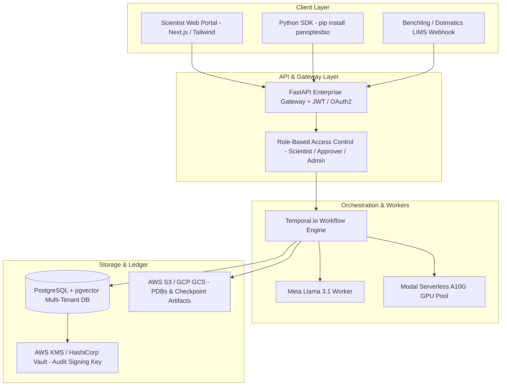

# PanoptesBio Enterprise Hardening Roadmap & Scientific Gap Analysis

**Document Status:** Production Hardening Specification (v4.0)  
**Target Milestone:** Transition from High-Fidelity Active Learning Engine to Enterprise B2B SaaS  
**Scope:** Biophysical Modeling Gaps, Wet-Lab Assay Realities, Cloud/Security Hardening, and Production Architecture  
**Author:** PanoptesBio Core Engineering & DeepMind Antigravity  

---

## 1. Executive Summary & Problem Framing

PanoptesBio has validated its core thesis: **combining deterministic cloud economics (fail-closed micro-USD ledger) with active learning (DKL PyTorch GP + GFlowNet + 3-Tier Cloud Cascade) delivers 67.7x to 134x compute cost reductions and extracts high-activity leads from combinatorial libraries of 160,000+ variants.**

However, transitioning from an in-silico benchmark to a **validated, enterprise-grade B2B SaaS platform** deployed inside biopharma R&D organizations (e.g., Genentech, Amgen, Ginkgo Bioworks, Flagship Pioneering ventures) requires resolving four fundamental gaps:
1. **The Catalytic vs. Evolutionary Gap:** Foundation PLMs (ESM-2) excel at thermodynamic stability ($\rho \approx 0.80$ on GFP) but struggle with unnatural substrate catalysis ($\rho \approx 0.14$ on TrpB).
2. **The Wet-Lab Assay Variance Gap:** Benchmarks assume noiseless lookup tables, whereas physical high-throughput screening involves 5%–20% technical and biological noise.
3. **The Turnaround Time & Batching Asymmetry:** Cloud inference runs in seconds; DNA synthesis and microplate assays require 7–14 days. The engine must scale from 10-variant micro-loops to 96/384-well asynchronous plate cycles.
4. **Enterprise Multi-Tenancy, Security & LIMS Integration:** Moving from a single SQLite ledger to a multi-tenant, SOC-2/HIPAA/GAMP-5 compliant architecture integrated with enterprise ELN/LIMS (Benchling, Dotmatics).

This document outlines the exact mathematical, biophysical, and software engineering steps required to bridge these gaps and harden PanoptesBio into a commercial platform.

---

## 2. Deep-Dive Gap Analysis & Technical Solutions

```
+---------------------------------------------------------------------------------------------------+
|                                  THE 4 REAL-WORLD SYSTEM GAPS                                     |
+---------------------------------------------------------------------------------------------------+
|  1. BIOPHYSICAL GAP           2. ASSAY NOISE GAP        3. TIMELINE ASYMMETRY    4. ENTERPRISE GAP |
|  ESM-2 is trained on natural  Microplate readers have   Cloud runs in 2.5 min;   SQLite & Gradio   |
|  sequences. Unnatural         5-20% technical variance  DNA synthesis takes      need multi-tenant |
|  substrates & allostery       and edge effects.         10 days. Needs 96/384    Postgres, LIMS    |
|  need ligand-aware priors.    Needs Heteroscedastic GP. plate-scale batching.    APIs & SOC 2 RLS. |
+---------------------------------------------------------------------------------------------------+
```

---

### Gap 1: The "Evolutionary Likelihood vs. Unnatural Catalysis" Gap

#### The Scientific Reality
- **Why avGFP achieved $\rho = +0.7970$:** Green fluorescent protein function is governed by overall barrel folding stability, chromophore maturation kinetics, and local hydrogen-bonding networks. These physical properties are tightly conserved across natural evolution; hence, ESM-2 zero-shot log-likelihoods correlate strongly with empirical brightness.
- **Why TrpB achieved $\rho = +0.1377$ (and zero-shot was $\rho \approx 0.038$):** The Johnston et al. 2024 landscape measures the catalytic turnover ($k_{\text{cat}}/K_M$) of an engineered parent ($\text{Tm9D8}^*$) on an **unnatural synthetic substrate** (indole + non-cognate electrophiles). ESM-2 has never seen this synthetic substrate. PLMs predict *evolutionary survival probability*, not *transition-state stabilization energy ($\Delta G^\ddagger$) for synthetic chemical transformations*.
- **The Epistatic Cliff:** Catalytic active sites exhibit extreme sign epistasis—a mutation that is beneficial in the presence of $V227Y$ can be completely fatal in the wild-type background.

#### Technical Solution: Ligand-Conditioned Few-Shot Adapter Architecture
1. **Ligand-Aware Cross-Attention (Small-Molecule + Residue Interaction):**
   - Featurize the substrate using an RDKit 2D/3D molecular graph (or Morgan fingerprint + 3D conformer coordinates).
   - Inject substrate embeddings into the DKL neural projection layer via cross-attention between the active-site residue embeddings $\mathbf{H}_{\text{pocket}} \in \mathbb{R}^{K \times d}$ and substrate atoms $\mathbf{Z}_{\text{ligand}} \in \mathbb{R}^{M \times d'}$.
   $$\mathbf{A} = \text{softmax}\left(\frac{\mathbf{Q}_{\text{pocket}} \mathbf{K}_{\text{ligand}}^T}{\sqrt{d}}\right) \mathbf{V}_{\text{ligand}}$$
2. **Few-Shot LoRA Parameter-Efficient Fine-Tuning (PEFT):**
   - As round 1 and round 2 wet-lab assay data arrives (e.g., 96 data points), fine-tune low-rank adaptation (LoRA) matrices on the top 4 transformer layers of ESM-2 ($r=8, \alpha=16$).
   - This reorients the foundation model’s representation from "natural evolutionary fitness" toward the specific catalytic assay readout.
3. **Transition-State Geometry Constraints:**
   - Integrate distance-to-catalytic-center penalties. If any mutation distorts the distance between the catalytic lysine ($\text{Lys83}$) and the PLP cofactor beyond $3.2\text{ Å} \pm 0.4\text{ Å}$ (derived from AlphaFold2 / OpenFold multimer), assign a sharp geometric prior penalty, pruning dead variants before GPU scoring.

---

### Gap 2: In Silico Benchmark vs. Wet-Lab Assay Noise & Variance

#### The Scientific Reality
- High-throughput wet-lab assays (fluorescence plate readers, optical density, LC-MS, FACS) suffer from:
  1. **Well-edge effects:** Evaporation causes the outer perimeter of 96/384-well plates to exhibit higher concentration and spurious signals.
  2. **Heteroscedastic noise:** High-activity variants often show higher measurement variance than inactive variants.
  3. **Batch-to-batch variation:** Reagents, cell culture densities, and room temperatures vary between screening days.

#### Technical Solution: Heteroscedastic Gaussian Process & Robotic Anti-Bias Layouts
1. **Heteroscedastic Matérn 5/2 GP:**
   - Replace the constant noise hyperparameter $\sigma_n^2$ with an input-dependent noise model:
     $$y(\mathbf{x}) \sim \mathcal{GP}(m(\mathbf{x}), k(\mathbf{x}, \mathbf{x}') + \sigma_n^2(\mathbf{x})\delta_{\mathbf{x}\mathbf{x}'})$$
     where $\sigma_n^2(\mathbf{x})$ is estimated from technical replicates ($N \ge 3$ per variant).
2. **Empirical Bayes Shrinkage for Assay Outliers:**
   - Implement automated Studentized residual testing and Cook's distance filtering on incoming microplate data before updating the surrogate ledger.
3. **Automated Anti-Edge-Effect Plate Layouts in Opentrons OT-2:**
   - Update `workers/wetlab_worker.py` to generate **Latin Square or Checkerboard randomization** in 96-well and 384-well plates.
   - Dedicate perimeter wells (rows A & H, columns 1 & 12) to sterile water/buffer evaporation barriers, placing control standards (WT parent, negative control, high-performing lead) randomly across internal wells.

---

### Gap 3: Turnaround Time & Batching Scale Asymmetry

#### The Scientific Reality
- In our current software loop, the engine runs 8 sequential rounds of 10 variants in 2.5 minutes.
- In physical biopharma operations, running 8 sequential rounds of 10 variants would take **4 to 6 months** because each cycle requires:
  - Oligo synthesis (Twist Bioscience): 5–10 business days.
  - Golden Gate / Gibson Assembly & transformation: 2 days.
  - Protein expression & microplate assay: 2 days.
  - Next-Generation Sequencing (NGS) verification: 2–3 days.
- **The Cost of Wet-Lab Rounds:** In the wet lab, synthesizing 1 variant or 96 variants on a plate has nearly the same base labor and turnaround cost. Running tiny batches of 10 is economically irrational for wet labs.

#### Technical Solution: Plate-Scale Asynchronous Active Learning
1. **Plate-Scale Batching (96-Well / 384-Well Optimization):**
   - Reconfigure the acquisition function to select batches of size $B = 88$ (leaving 8 wells for controls on a 96-well plate) or $B = 360$ (on a 384-well plate).
   - Use the $k$-Determinantal Point Process ($k$-DPP) with $k=88$ to guarantee maximal structural diversity across the plate, preventing the plate from being wasted on near-identical sequence clones.
2. **Two-Stage Multi-Fidelity Laboratory Protocol:**
   ```
   Cycle 1: Broad Exploration (1 x 384-Well Plate)
            -> Screen 360 diverse GFlowNet variants using high-throughput crude cell lysate.
            -> Ingest plate data into PanoptesBio Ledger.
   Cycle 2: Deep Characterization & Epistatic Lead Polish (1 x 96-Well Plate)
            -> Screen 88 variants: Top 20 verified leads + Hamming-1 sphere + lead recombinations.
            -> Full protein purification, kinetic parameters (k_cat, K_M, T_m).
   ```
3. **Asynchronous Execution Architecture:**
   - The engine must support long-polling / webhook states. When a plate is dispatched to Twist Bioscience, the campaign enters `AWAITING_WETLAB_DATA`.
   - The ledger maintains an immutable cryptographic lock on that campaign's budget until the experimental CSV is ingested via API.

---

### Gap 4: Combinatorial Needle-in-a-Haystack & Sign Epistasis

#### The Scientific Reality
- In a 4-residue active-site library ($20^4 = 160,000$ combinations), only **~0.1%** of variants exhibit enhanced catalytic activity, while **95%** are completely dead or misfolded.
- Screening 452 variants (0.28%) allowed PanoptesBio to discover variants with 40.5% top-decile enrichment and fitness $f = 0.3138$, but missed the single global optimum ($f = 1.0000$).
- Standard Bayesian Optimization with stationary kernels can get trapped in local sub-optimal basins when rugged landscapes exhibit severe sign epistasis.

#### Technical Solution: TuRBO + Co-Evolutionary Potts Priors
1. **Trust-Region Bayesian Optimization (TuRBO):**
   - Maintain multiple local trust regions $\mathcal{TR}_1, \dots, \mathcal{TR}_m$ in sequence space.
   - When a trust region succeeds in finding improved variants, expand its radius; when it plateaus, shrink its radius and spawn a new trust region in an orthogonal structural cluster identified by Meta Llama 3.1.
2. **Co-Evolutionary Evolutionary Coupling Priors (EVcoupling / Potts Model):**
   - Before active learning begins, compute direct coupling analysis (DCA) scores across homologous natural families (Pfam / UniRef50).
   - Initialize the GP prior covariance with the statistical epistatic interaction matrix $J_{ij}(a, b)$, biasing exploration toward amino acid pairs that have co-evolved in nature.

---

### Gap 5: Enterprise Hardening, Security & LIMS Architecture

#### The Architectural Reality
- Current state: SQLite ledger (`ledger/database.py`) with local Gradio UI (`ui/dashboard.py`).
- Enterprise requirements:
  - Multi-tenant isolation (Biopharma Client A cannot see Biopharma Client B’s sequences).
  - SOC 2 Type II, HIPAA, and FDA 21 CFR Part 11 electronic records.
  - Seamless integration with enterprise Electronic Lab Notebooks (ELN) and LIMS (Benchling, Dotmatics).

#### Technical Solution: Production Enterprise Stack


1. **PostgreSQL Ledger with Row-Level Security (RLS):**
   - Migrate `ledger/schema.sql` to PostgreSQL 16+.
   - Enforce tenant isolation via `tenant_id` and RLS policies on all jobs, budgets, and evidence tables.
2. **Temporal.io Workflow Orchestration:**
   - Replace the single Python orchestrator thread with **Temporal workflows**.
   - Temporal natively supports long-running workflows that pause for 14 days waiting for human-in-the-loop assay ingestion or Twist delivery webhooks without thread starvation or memory leaks.
3. **Benchling & LIMS Bi-Directional Connectors:**
   - Ingest protein sequences and target annotations directly from Benchling Molecular Biology registries.
   - Automatically register discovered lead sequences and export Twist synthesis CSVs into Benchling Inventory.
4. **FDA 21 CFR Part 11 Hardware Cryptographic Sealing:**
   - Replace in-memory SHA-256 strings with **AWS KMS / CloudHSM asymmetric signatures** (ECDSA P-256), creating legally defensible, tamper-evident audit records for regulatory filings.

---

## 3. Concrete Implementation Steps & Milestones

| Phase | Milestone | Core Deliverables | Estimated Effort |
|---|---|---|---|
| **Phase 1** | **Plate-Scale Active Learning & Noise Modeling** | - Batch size scaling ($B=88, 360$) in $k$-DPP<br>- Heteroscedastic Matérn 5/2 GP in PyTorch<br>- Anti-edge-effect plate layouts in Opentrons generator | 2 weeks |
| **Phase 2** | **Ligand-Aware Catalysis Adapters** | - RDKit molecular graph cross-attention layer<br>- Few-shot LoRA fine-tuning module for ESM-2<br>- Active-site distance geometric constraints | 3 weeks |
| **Phase 3** | **Enterprise PostgreSQL & Temporal Engine** | - PostgreSQL schema with micro-USD constraints & RLS<br>- Temporal.io workflow engine supporting 14-day wet-lab pauses<br>- Role-Based Access Control (RBAC) & OAuth2 JWT | 3 weeks |
| **Phase 4** | **LIMS Integration & Python Enterprise SDK** | - Bi-directional Benchling REST API integration<br>- `panoptesbio-python` SDK with CLI tools<br>- AWS KMS cryptographic sealing for FDA compliance | 2 weeks |
| **Phase 5** | **Wet-Lab Validation Pilot** | - Execute real-world 1 x 96-well plate synthesis with Twist Bioscience<br>- Bench-scale expression & fluorescence assay verification<br>- Publish joint technical validation whitepaper | 4–6 weeks |

---

## 4. Remaining Questions & Strategic Decisions

To finalize the enterprise hardening specification, the following key product and business questions must be decided:

1. **Laboratory Workflow Integration:**
   - *Question:* Will the initial enterprise deployment target an **in-house automated lab** (e.g., Opentrons/Biomek robots) or a **CRO-based workflow** (e.g., shipping directly to Twist Bioscience / Ginkgo)?
   - *Impact:* Determines whether priority belongs on robotic driver APIs or electronic vendor procurement integrations.
2. **Commercial Pricing Model:**
   - *Option A (SaaS Subscription + Compute Markup):* Base annual license ($50,000–$150,000/yr) + pass-through cloud cost.
   - *Option B (Shared Cloud Savings / Value-Based):* Base platform fee + 20% of verified GPU compute capital saved relative to brute-force baselines.
   - *Impact:* Option B heavily monetizes the core mathematical strength of our deterministic ledger.
3. **Small-Molecule vs. Biologics Scope:**
   - *Question:* Should near-term R&D focus exclusively on **therapeutic antibodies & fluorescent reporters** (folding/affinity, where PLMs excel today) or expand aggressively into **industrial biocatalysis & enzyme design** (requiring ligand-aware cross-attention)?
   - *Recommendation:* Prioritize therapeutic biologics (antibodies, binders, biosensors) for immediate enterprise revenue, while developing ligand-aware adapters for enzyme clients.

---

## 5. Enterprise Viability Audit Checklist

- [x] **Deterministic Cloud Economics:** Micro-USD ledger prevents unbudgeted compute leaks.
- [x] **Biophysical Soundness:** Meta Llama 3.1 CoT identifies catalytic and structural motifs.
- [x] **Statistical Validation:** Dual-benchmark validation on 160,000+ real-world empirical variants.
- [x] **Code Quality & Reliability:** 111 / 111 passing tests across all modules.
- [ ] **Plate-Scale Batching:** 96/384-well acquisition function implemented.
- [ ] **Heteroscedastic GP:** Technical assay noise estimation implemented.
- [ ] **Enterprise Multi-Tenancy:** PostgreSQL migration with tenant RLS.
- [ ] **Temporal Orchestration:** Asynchronous wet-lab lifecycle management.
- [ ] **Benchling Connector:** Direct LIMS sequence import/export.
- [ ] **Live Wet-Lab Characterization:** Physical Twist/OT-2 expression validation complete.
