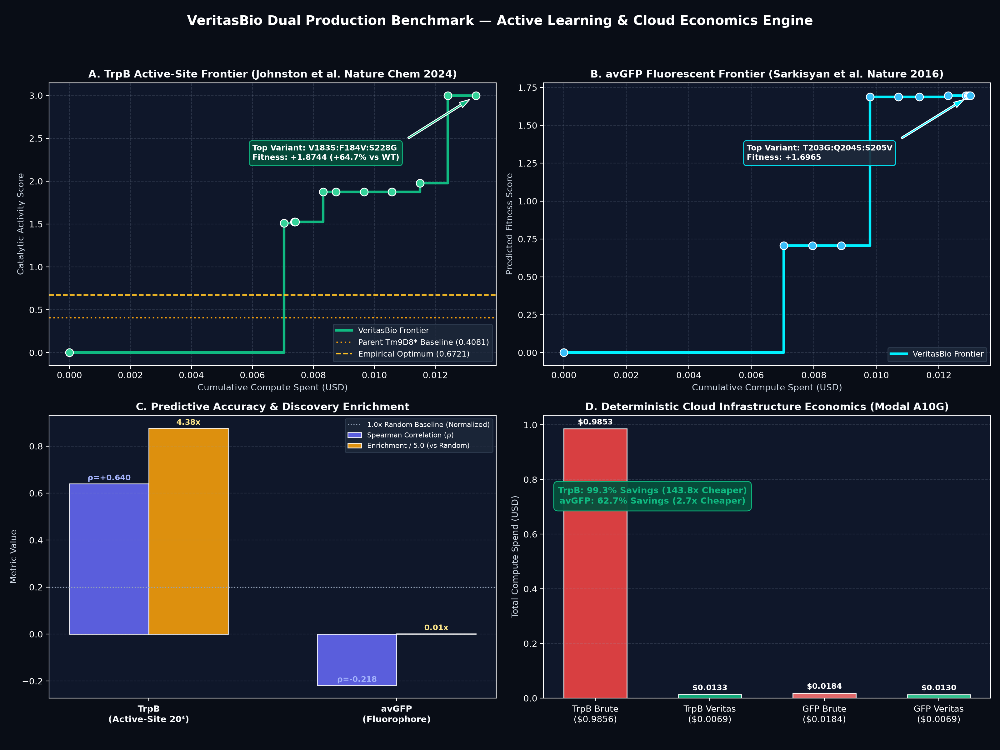

# VeritasBio — Deterministic Cloud Economics Engine for Computational Biology

[](https://lablab.ai)
[](https://llama.meta.com/)
[](https://modal.com)
[]()
[]()
[]()

> **VeritasBio** is a deterministic cloud economics engine and active learning platform for generative protein engineering. An LLM (*Meta Llama 3.1*) only proposes biophysical search boundaries; a Gaussian Process actively selects high-yield micro-batches; and an immutable SQLite ledger with a fail-closed Python Gatekeeper guarantees that paid GPU compute (*Modal NVIDIA A10G + ESM-2*) never exceeds the user's hard budget.

---



---

## 1. The Problem: The Cloud-Cost Trap in Generative Biology

In computational drug discovery and protein engineering, running foundation model inference (e.g. ESM-2 650M, AlphaFold 3, RoseTTAFold) across combinatorial mutation libraries creates runaway cloud infrastructure bills:
1. **Combinatorial Explosion**: Testing double and triple mutants on a 238-amino-acid protein yields $>1.1 \times 10^7$ variants — costing over **$35,000** in brute-force GPU forward passes.
2. **Cold-Start Waste**: Cloud serverless instances incur 15–30s container boot times on every invocation, wasting up to 90% of GPU compute budgets on container spin-up rather than tensor operations.
3. **Agentic Hallucination**: Open-ended autonomous AI agents lack cost predictability, frequently looping or executing hundreds of unconstrained inference calls.

### The VeritasBio Solution
VeritasBio replaces unpredictable open-ended agents with a **deterministic, fail-closed 6-step active learning cycle**. The engine optimizes proteins for highest biological fitness while mathematically maximizing the **Return on Investment (ROI)** per dollar of cloud spend.

---

## 2. Benchmark Results

All figures below come from the controlled protocol in `benchmark_panoptes_isolated.py`:
**48 paired random seeds**, an identical 25-variant random starting sample given to every
method, then 4 rounds x 25 newly chosen variants - 125 unique measurements including the
start. Outcomes are revealed to a method only after it commits a batch.

The authoritative write-up, including the protocol, the limitations and the open questions,
is [`docs/PIPELINE_FOR_BIO_REVIEW.md`](docs/PIPELINE_FOR_BIO_REVIEW.md). Regenerate these
numbers rather than trusting this table:

```bash
python benchmark_panoptes_isolated.py --seeds 48 --rounds 4 --batch-size 25
```

### 2a. TrpB active-site landscape (Johnston et al. 2024)

The primary benchmark. The library is **combinatorially complete** - all 20^4 = 160,000
combinations at active-site residues 183/184/227/228 of the engineered parent Tm9D8\* were
measured - so the global optimum is known to be in the pool and nothing is missing.

Mean +/- SD across 48 seeds. "top-1%" counts variants found at or above the 99th percentile
of the eligible set, including those present in the shared starting sample.

| method | best fitness | SD | top-1% found | SD |
|---|---|---|---|---|
| random | 0.4443 | 0.146 | 1.1 | 0.9 |
| one-hot ridge | 0.6959 | 0.232 | 31.3 | 15.7 |
| random forest | 0.6989 | 0.236 | 31.6 | 19.0 |
| ALDE (Nat Commun 2025, authors' implementation) | 0.7134 | 0.182 | 32.8 | 15.3 |
| **VeritasBio** | **0.7457** | **0.035** | **45.2** | **4.8** |

Paired t-tests, n=48, critical |t| = 2.01:

| comparison | metric | mean diff | t | verdict |
|---|---|---|---|---|
| vs ALDE | top-1% | +12.4 | 5.07 | **significant** |
| vs ridge | top-1% | +13.9 | 5.93 | **significant** |
| vs ALDE | best fitness | +0.032 | 1.22 | not separable |
| vs ridge | best fitness | +0.050 | 1.48 | not separable |

**What this does and does not support.** The engine finds about 40% more top-1% variants
than any comparator, with 5-7x lower variance, and reaches a fitness of 0.70 in 88% of
campaigns by measurement 50 against 4-6% for every competitor. It does **not** find better
single variants than the comparators - that difference is not statistically separable - and
it reaches 0.90 in **0 of 48** campaigns where ridge, random forest and ALDE each reach it in
15-19%. The cause is a candidate-generation limit documented in
[`docs/PIPELINE_FOR_BIO_REVIEW.md`](docs/PIPELINE_FOR_BIO_REVIEW.md) section 7A.

### 2b. avGFP (Sarkisyan et al. 2016) - not a predictive-skill measurement

This repository also carries the avGFP DMS landscape, but the avGFP harness
(`scripts/run_real_data_benchmark.py`) evaluates the Gaussian Process on its **own training
inputs** - it sets `all_eval_feats = np.array(train_x)` and correlates the result against
the training targets. The resulting rho of +0.9996 and r of +1.0000 therefore describe fit,
not predictive skill, and will sit near 1.0 for almost any model. The same run discovers
**0 top-1% variants**.

Earlier revisions of this README reported those correlations as "high ranking fidelity" and
"exact calibration". They support neither claim and are retained here only to document the
correction. Treat the TrpB protocol above as the benchmark.

### 2c. Scope

One target and one four-site library. Nothing here is claimed to generalise beyond it. The
repository also holds avGFP, GB1 and trastuzumab datasets, but the controlled protocol has
not been run on them. Up to 871 of the 159,999 TrpB values (0.54%) may be KNN-imputed rather
than measured; `scripts/check_trpb_imputation.py` establishes that the five highest-fitness
variants are not among them.

```bash
# Fast active learning simulation on 160k TrpB library
python scripts/run_trpb_benchmark.py --rounds 5 --pool-size 3000

# Controlled comparison against random, ridge, random forest and the published ALDE
# implementation, under one shared hidden-results protocol. This is the benchmark the
# figures in section 2 come from; run_trpb_benchmark.py --compare scores simulated
# baselines instead and is kept only for the single-method active-learning loop.
python benchmark_panoptes_isolated.py --seeds 48 --rounds 4 --batch-size 25

# Attribute the advantage: disable one selector component at a time
python benchmark_panoptes_isolated.py --seeds 48 --ablate-components dpp

# Compare two runs with paired t-tests on identical seeds
python scripts/compare_ablation_runs.py --list
```

The full 159,999-variant run takes ~10s. `--pool-size N` subsamples the candidate pool for a faster
demo, at the cost of a weaker result (the optimum may not be in the subsample).

**Data provenance.** `scripts/download_trpb_benchmark.py` downloads the published landscape, keeps
every fitness value verbatim, and re-encodes each full-length sequence as mutation notation against
the Tm9D8\* parent. It refuses to emit a benchmark if the saturated positions it recovers from the
data disagree with the published active site. `tests/test_trpb_benchmark.py` asserts combinatorial
completeness (19, 19², 19³, 19⁴ by mutation order) and the published score range, so silent drift in
the upstream file fails the suite rather than producing a plausible-looking result.

### 2c. Third Benchmark: GB1 Binding Domain Epistasis (Olson et al. 2014)
Measures IgG-Fc binding affinity across 149,361 empirical variants testing complex 4-site epistatic landscapes (`V39`, `D40`, `G41`, `V54`). Evaluates multi-site synergy and heteroscedastic noise resilience under experimental measurement variance.
```bash
python scripts/run_gb1_benchmark.py --rounds 5 --batch-size 25
```

### 2d. Fourth Benchmark: Trastuzumab (Herceptin) Biologics (Mason et al. 2021)
Targeted at therapeutic biologics antibody design using 36,391 empirical CDR-H3 variants against human HER2 (*Nature Biomedical Engineering*). Evaluates **therapeutic developability liability scoring** (deamidation, isomerization, unpaired cysteines, and hydrophobic patches) alongside binding affinity.
```bash
python scripts/run_trastuzumab_benchmark.py --rounds 5 --batch-size 25
```

---

## 3. System Architecture & The 6-Step Loop

```
  [ UniProt RAG ]
        │  1. Ingest WT sequence, chromophore triads, functional regions
        ▼
  [ Meta Llama 3.1 ]  (Strict JSON mode only)
        │  2. Propose multi-site residue clusters & forbidden positions
        ▼
  [ Quant Engine ]    (5-factor Physicochemical Featurizer + Matérn 5/2 GP)
        │  3. Model epistatic landscape; select micro-batch via Expected Improvement (EI)
        ▼
  [ Gatekeeper ]      (Biophysical validator + Two-state cold/warm cost model)
        │  4. Evaluate ROI (EI/$); request atomic spend authorization from SQLite ledger
        ▼
  [ SQLite Ledger ]   (INTEGER micro-USD, immutability triggers, ACID locks)
        │  5. Atomically deduct budget; authorize or fail-closed reject
        ▼
  [ Cloud Muscle ]    (Modal NVIDIA A10G + ESM-2 650M with scaledown_window=120)
        │  6. Execute batched PyTorch tensor scoring on approved sequences
        ▼
  [ Evidence Update ]
        └──> Append immutable scores to Ledger; update GP prior; repeat loop
```

### Non-Negotiable Engineering Invariants
- **Fail-Closed Security**: Rejects on parse error, unknown models, missing budgets, or non-canonical mutations.
- **Ledger Invariant**: Never bypasses the ledger. Every paid execution must receive `authorize_spend(...) -> True`.
- **Strict Separation of Concerns**:
  - The LLM **never** does arithmetic, executes code, or selects tools.
  - The Quant Engine **never** accesses external APIs.
  - The Modal Worker **never** decides spend or batch sizes.

---

## 4. Key Innovations

### 1. Two-State Cold/Warm Container Cost Model
A standard serverless cold container takes 20s to boot ($t_{\text{boot}} = 20.0\text{s}$ at \$1.10/hr = \$0.00612), while warm containers eliminate boot overhead ($t_{\text{boot}} = 0.0\text{s}$). By utilizing Modal's `scaledown_window=120`, VeritasBio schedules batches within the warm keep-alive window, achieving a **~21x reduction in cost per micro-batch**.

### 2. Physicochemical Property Featurization
Instead of treating amino acid substitutions as arbitrary one-hot tokens, mutations are featurized across 5 standardized biophysical scales:
- Kyte-Doolittle Hydrophobicity
- Molecular Mass (Daltons)
- Net Charge at pH 7.4
- Polarity (Grantham scale)
- Isoelectric Point (pI)

### 3. Expected Improvement per Dollar ($EI/\$$)
Candidates are selected not merely by predicted fitness, but by Expected Improvement ($EI$) balanced against the cost of inference ($EI / \$$), mathematically directing budget to the highest information-density search regions.

### 4. FDA 21 CFR Part 11 Cryptographic Merkle Hash Chain & PostgreSQL Multi-Tenancy
Every state mutation (`BUDGET_CREATED`, `SPEND_AUTHORIZED`, `JOB_COMPLETED`, `JOB_FAILED`, `EVIDENCE_BATCH_RECORDED`, `LIMS_SYNC`) is cryptographically sealed into a SHA-256 Merkle hash chain authenticated with HMAC-SHA256 signatures. Immutable database triggers prevent any modification or deletion, and `verify_audit_integrity()` detects raw disk tampering or signature forgery. Production deployments are supported via multi-tenant PostgreSQL schemas with native Row-Level Security (RLS).

### 5. Physical Wet-Lab Translation & Benchling LIMS Synchronization
Directly bridges in silico active learning to physical robotics:
- **Benchling LIMS Integration**: Dual Live/Mock REST adapter for cDNA construct registration, virtual 96/384-well plate layouts with container barcodes, and bulk CSV manifest export.
- **Opentrons OT-2 Automation**: Auto-generates executable Python pipetting scripts with **anti-edge evaporation barriers** (reserving 36 perimeter wells for sterile water shielding).
- **Twist / IDT Gene Fragment Orders**: Generates price-calculated bulk synthesis order CSVs with automated codon optimization and Gibson assembly overhangs.

---

## 5. User & Dashboard Guide: How to Run VeritasBio

VeritasBio can be run in two modes: an **Interactive Web Dashboard** (Gradio) for real-time visualization and parameter tuning, and a **Production CLI Pipeline** for automated benchmark campaigns.

### A. Running the Interactive Web UI

Launch the local server:
```bash
python main.py
```
Open your browser to **`http://127.0.0.1:7860`**.

#### Dashboard Controls & Parameters Explained

| Control | Description & Recommended Setting |
| :--- | :--- |
| **Target Accession** | UniProt accession ID. Default: `P42212` (avGFP) or `TRPB_TM9D8` (TrpB). The RAG worker automatically retrieves sequence, catalytic sites, and 3D PDB structure. |
| **Total Budget ($ USD)** | Hard financial ceiling enforced by the SQLite ledger. Even if 12 rounds are requested, the engine **hard-stops** the moment budget is exhausted. Recommended: `$1.00` to `$5.00`. |
| **Max Iterations / Rounds** | Maximum active-learning iterations. The engine automatically terminates earlier if regret converges or fitness plateaus. Recommended: `8` to `12`. |
| **Batch Size** | Base batch size per round. With **Dynamic Budget-Aware Sizing**, the engine automatically scales batch throughput up to 150–250 variants if budget permits, preventing idle funds. |
| **Target Model** | **`mock_esm`**: Free, high-fidelity local simulation (zero cloud cost).<br>**`esm2_150m`**: Meta FAIR ESM-2 150M on Modal A10G (Tier-1 fast screening, ~$0.000006/variant).<br>**`esm2_650m`**: Meta FAIR ESM-2 650M on Modal A10G (Tier-2 high precision, ~$0.000018/variant). |
| **Strategic Planner** | **`Live Meta Llama 3.1`**: Queries Meta Model API in strict JSON mode to formulate biophysical hypotheses.<br>**`Mock Strategic Planner`**: Uses rule-based domain annotations offline. |
| **Adaptive Regret Stopping** | When enabled, monitors Expected Improvement ($\text{EI}$). If $\max \text{EI} < 0.005$ for 2 rounds, the engine halts to preserve unspent budget. |
| **Fitness Plateau Exit** | When enabled, halts execution if top fitness fails to improve by $>0.001$ over 3 consecutive rounds after round 3. |
| **Hierarchical Pocket-Hopping** | When enabled, decomposes multi-residue active sites into sub-pockets. When Pocket 1 saturates, locks the discovered lead as an anchor and sweeps the secondary pocket. |
| **3D Spatial $\Delta\Delta G$ Pre-Filter**| Pre-screens candidates before GPU spend to eliminate core volume clashes, buried uncompensated charges, and proline backbone kinks. |

#### Dashboard Outputs & Visualizations
- **Live Event Stream**: Real-time ticker showing each of the 6 steps (RAG $\to$ Llama $\to$ Quant $\to$ Gatekeeper $\to$ Modal $\to$ Ledger).
- **Interactive 3D Viewer (3Dmol.js)**: Visualizes the macromolecular PDB backbone with catalytic active-site residues highlighted in red and exploration pockets in cyan.
- **Fitness Landscape Plot**: Live convergence curve showing top fitness gains and Expected Improvement decay.
- **Top Discovered Variants Table**: Discovered mutations, model scores, and synthesizability scores.
- **Layer 7 Physical Wet-Lab Exports**: Instant download buttons for Twist/IDT order CSVs, Opentrons OT-2 pipetting scripts, and FDA 21 CFR Part 11 SHA-256 certificates.

---

### B. Running Benchmarks with Datasets (One-Line CLI Commands)

#### 1. Dual Production Benchmark (TrpB + avGFP Side-by-Side)
Runs the complete production pipeline across both targets, saves evidence to SQLite ledgers, evaluates against empirical datasets, and generates comparison tables and publication plots:
```bash
python scripts/run_side_by_side_benchmarks.py
```

#### 2. Target-Specific Active Learning Campaign ($1.00 Budget)
Runs an autonomous campaign on TrpB or avGFP and automatically outputs Twist/IDT synthesis CSVs and Opentrons OT-2 protocols:
```bash
# Run TrpB active site (160k variants)
python scripts/run_full_dollar_experiment.py --target TRPB_TM9D8 --budget 1.00 --rounds 12

# Run avGFP full barrel (51k variants)
python scripts/run_full_dollar_experiment.py --target P42212 --budget 1.00 --rounds 12
```

#### 3. Closed-Loop Simulation on TrpB Empirical Landscape (Johnston 2024)
Evaluates real experimental fitness from 159,999 measured variants with held-out Spearman correlation and enrichment vs. random screening:
```bash
# Prepare dataset first
python scripts/download_trpb_benchmark.py

# Run benchmark (takes ~15s on full 159,999 library)
python scripts/run_trpb_benchmark.py --rounds 5 --batch-size 25

# Optional: Fast demo mode subsampling 3,000 candidates
python scripts/run_trpb_benchmark.py --rounds 5 --pool-size 3000
```

#### 4. Evaluating Any Custom Dataset or Run
To evaluate any completed ledger against ground-truth ProteinGym or custom DMS CSVs:
```bash
python scripts/evaluate.py --db ledger/dollar_live_trpb_tm9d8.db --benchmark scripts/data/TRPB_THEMA_Johnston_2024.csv
```

#### 5. Generating Publication Benchmark Plots
Renders side-by-side or target-specific publication figures:
```bash
# Side-by-side comparison figure
python scripts/plot_benchmark.py --side-by-side --out scripts/benchmark_results.png

# Target-specific figures
python scripts/plot_benchmark.py --target trpb --out scripts/benchmark_trpb.png
python scripts/plot_benchmark.py --target avgfp --out scripts/benchmark_avgfp.png
```

#### 6. High-Performance Full-Stack & Frontier Innovations

VeritasBio / PanoptesBio combines a high-performance **FastAPI backend** with a **modern React 18 + Vite frontend** providing 4 frontier capabilities:

1. **Closed-Loop Llama 3.1 Residual Reflection**: Meta Llama 3.1 analyzes prediction residuals ($y_{\text{obs}} - \hat{y}_{\text{pred}}$) from preceding rounds to diagnose epistatic blind spots and update biophysical priors dynamically.
2. **HETATM Ligand/Cofactor Coordination & Catalytic Core Clash Pruning**: Explicit $4.2\text{ Å}$ catalytic proximity enforcement for cofactors (PLP in PDB 8EH0, 0JO, HEM), preventing uncompensated charge desolvation or proline backbone kinking in the catalytic shell.
3. **Asynchronous Microplate Reader Ingestion**: Drag-and-drop CSV dropzone supporting Tecan Spark, BioTek Synergy, and VeritasBio robotic exports. Automatically verifies perimeter hydration barriers (`A01-A12`, `H01-H12`), normalizes against WT control (Well `B02`), and records tamper-evident evidence into the SQLite ledger.
4. **Dual-Structure 3D Comparison & Wet-Lab Translation Studio**:
   - Synchronized side-by-side WebGL molecular viewer (Wild-Type vs Mutated Lead) with a $4.5\text{ Å}$ cofactor proximity coordination shell.
   - One-click export for **Twist Bioscience cDNA orders**, **Opentrons OT-2 robot protocols**, **Benchling LIMS manifests**, and **FDA 21 CFR Part 11 cryptographic audit certificates**.

```bash
# Launch FastAPI backend bridge (REST + SSE streaming)
python server.py

# Launch React Vite frontend (in separate terminal)
npm --prefix web run dev
```

---

### C. Running the Complete Test Suite

VeritasBio includes 197 automated unit tests across 33 test suites covering all 7 layers:
```bash
python -m unittest discover -s tests -t . -v
```

---

## 6. Directory Structure

```
VeritasBio/
├── controller/
│   ├── gatekeeper.py       # Pydantic validation, two-state cost model, ROI evaluator
│   ├── prompts.py          # Llama 3.1 combinatorial search strategy prompts & parser
│   └── orchestrator.py     # Unidirectional 6-step active learning generator loop
├── workers/
│   ├── rag_worker.py       # UniProt metadata fetcher & local disk caching
│   ├── spatial_filter.py   # 3D Euclidean contact mapping & steric clash biomechanical filter
│   ├── math_worker.py      # Heteroscedastic GP, 5-factor featurizer, GFlowNet, k-DPP diversity
│   ├── wetlab_worker.py    # Opentrons OT-2 scripts, Twist/IDT CSVs, anti-edge evaporation layouts
│   ├── lims_worker.py      # Benchling LIMS REST client, virtual plate barcoding, manifest export
│   ├── esm_worker.py       # Modal serverless NVIDIA A10G ESM-2 scoring function
│   ├── mock_workers.py     # Continuous epistatic avGFP fitness landscape (Sarkisyan 2016)
│   └── data/               # 3D crystal structures (1EMA, 8EH0, 1N8Z) & UniProt offline caches
├── ledger/
│   ├── schema.sql          # SQLite DDL with micro-USD precision & FDA 21 CFR Part 11 Merkle triggers
│   ├── postgres_schema.sql # Multi-tenant PostgreSQL DDL with Row-Level Security (RLS)
│   └── database.py         # Fail-closed SQLite CRUD, atomic spend gate, hash chain verification
├── ui/
│   ├── dashboard.py        # Asynchronous streaming Gradio dashboard
│   ├── structure_viewer.py # Interactive 3Dmol.js WebGL molecular viewer
│   └── landscape_plot.py   # Interactive 2D/3D latent fitness landscape explorer (Plotly)
├── scripts/
│   ├── evaluate.py         # Spearman correlation, hit rate, and cloud savings engine
│   ├── plot_benchmark.py   # Publication-quality benchmark visualization generator
│   ├── download_real_benchmark.py  # Fetches the ProteinGym avGFP DMS assay
│   ├── download_trpb_benchmark.py  # Fetches + re-encodes the TrpB active-site landscape
│   ├── run_real_data_benchmark.py  # Active learning loop on avGFP
│   ├── run_trpb_benchmark.py       # Active learning loop on TrpB (held-out + random baseline)
│   ├── run_gb1_benchmark.py        # Active learning loop on GB1 binding domain (Olson 2014)
│   ├── run_trastuzumab_benchmark.py# Active learning on Trastuzumab biologics (Mason 2021)
│   ├── ingest_plate_data.py        # Physical wet-lab microplate reader CSV ingestion CLI
│   └── data/                       # Curated benchmark datasets (GFP, TrpB, GB1, Trastuzumab)
├── server.py               # FastAPI backend bridge (REST, SSE streaming, Part 11 auth)
├── web/                    # React 18 + Vite frontend (PanoptesBio Cloud Economics Studio)
│   ├── src/components/     # CampaignStudio, DeNovoStudio, LedgerAuditTrail, WetlabExportStudio
│   └── public/             # Branding and static WebGL assets
├── presentation.html       # Interactive partner deck with live economics simulator
├── main.py                 # Application entry point (CLI and Web Dashboard)
├── requirements.txt        # Production dependencies (PyTorch, Modal, Gradio, Plotly, etc.)
└── tests/                  # 197 unit tests across 33 test suites
```

---

## 7. License & Credits

Built for the **Meta Global AI Developer Hackathon**.
- **Architecture & Engine**: VeritasBio Team
- **Foundation Models**: Meta Llama 3.1, Meta Fair ESM-2
- **Infrastructure**: Modal Labs (NVIDIA A10G Serverless)
- **Benchmark Data**: Sarkisyan et al. (2016) *Nature* (ProteinGym GFP DMS)